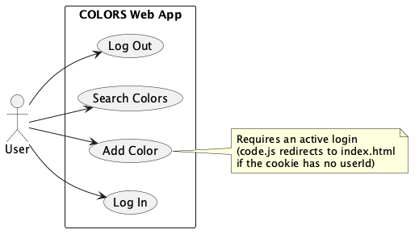
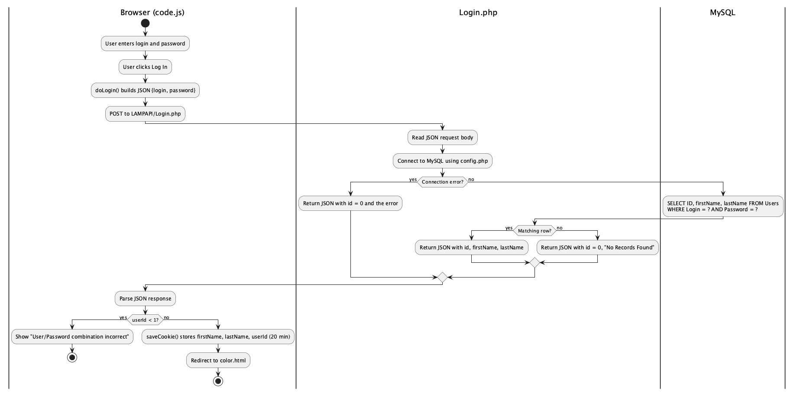
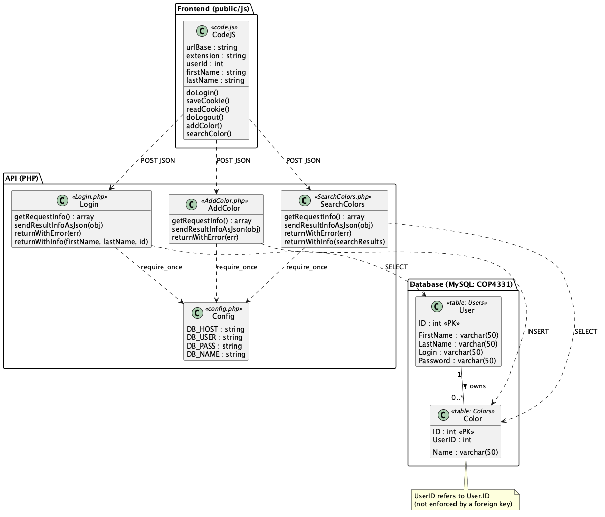

# COLORS-LAMP

This project hosts the files for a LAMP-stack web app where users log in and add/search their own colors.

## Built With

- PHP
- Ubuntu on DigitalOcean
- Apache
- MySQL
- HTML/CSS/JavaScript with AJAX

## Repository structure
```
colors-lamp/
├── api/
│   ├── config.example.php
│   ├── config.php (not committed; you create this)
│   ├── Login.php
│   ├── AddColor.php
│   └── SearchColors.php
├── public/
│   ├── index.html
│   ├── color.html
│   ├── css/
│   ├── images/
│   └── js/
├── .github/workflows/lint.yml
├── docs/uml/
├── eslint.config.mjs
├── package.json
├── package-lock.json
├── .htmlhintrc
├── .stylelintrc.json
├── .gitignore
├── LICENSE.md
└── README.md
```

## Setup
- Create a LAMP droplet and point a domain at it
- Create the database and tables (`Users`, `Colors`)
- Copy `api/config.example.php` to `api/config.php` and fill in real credentials
- Upload `api/` → `/var/www/html/LAMPAPI/` and `public/` contents → `/var/www/html/`
- Change `urlBase` in `js/code.js` to your own domain 

## Running/accessing it

1. Visit the domain (http://kbcop4331c.xyz)
2. Log in
3. Add colors
4. Search colors

## UML Diagrams

PlantUML source files and rendered images are in `docs/uml/`. To re-render after editing a `.puml` file:
`plantuml -tpng docs/uml/<name>.puml`

### Use Case Diagram


### Activity Diagram (Login Flow)


### Class Diagram


## Linting (CI)

A GitHub Actions workflow (`.github/workflows/lint.yml`) runs on every push and pull request and checks:
- **HTML**: HTMLHint (`.htmlhintrc`)
- **CSS**: Stylelint with `stylelint-config-standard` (`.stylelintrc.json`)
- **JavaScript**: ESLint recommended rules (`eslint.config.mjs`)

Node.js is used only to install and run the linters, not to run the app. To lint locally:
`npm ci` then `npm run lint`

`md5.js` is excluded because it's a third-party library. The ID selector rule is configured for camelCase because the JavaScript looks up elements by camelCase IDs.

## Limitations
- `userId` comes from the request body in `AddColor.php` and `SearchColors.php`. Anyone could send `"userId": 3` and read or add another user's colors.
- String-built JSON functions need to be rebuilt with `json_encode()` to avoid broken JSON.
- SearchColors' `returnWithError` includes `id`, `firstName`, and `lastName` fields that don't belong to a search response.
- AddColor always reports success (`error: ""`), even if the insert silently fails.
- The frontend throws an error when a search has no matches.
- `userId` lives in a plain cookie. Anyone can edit it in dev tools and become another user.
- Passwords go over plain HTTP, unhashed (the `md5` lines are commented out and there's no HTTPS).

## License
- MIT (see LICENSE.md)

## AI Assistance Disclosure
This repository was organized and documented with help from a generative AI tool, per the COP 4331C AI Use Policy.

- **Tool**: Claude Opus 5.5 (Anthropic, accessed via claude.ai)
- **Date**: September 27, 2026
- **Scope**: Git/GitHub workflow for this assignment, reviewing my changes to the lab code before committing, and identifying limitations of the existing code
- **Use**:
  - Suggested a commit breakdown for organizing the lab files into logical stages
  - Walked me through how to implement `.gitignore` and verifying the ignore rule with `git check-ignore`
  - Reviewed my config files and pointed out fixes (removing whitespace before `<?php` and dropping the closing `?>` to avoid "headers already sent" errors)
  - Reviewed `Login.php`, `AddColor.php`, `SearchColors.php`, and `code.js` and helped identify and described the issues listed under the limitations section
  - Explained concepts I asked about, including AJAX, the `.vscode/` folder, and `.DS_Store`

**Example prompts used:**
- "Is this all I need inside my api/config.example.php file?" (followed by my draft)
- "Can you check on my other files before I commit them?" (followed by my AddColor.php and SearchColors.php)
- "Here's my code.js file, I didn't see anything sensitive but I wanted to check with you first:" (followed by my code.js)

 ### Assignment 2: UML Diagrams

- **Tool**: Claude Opus 5.5 (Anthropic, accessed via claude.ai)
- **Date**: November 1, 2026
- **Use**:
  - Drafted the PlantUML source for the use case, activity, and class diagrams based on the code in this repository
  - Explained PlantUML setup and rendering
- **Verification**: I checked each diagram against the actual code and the live app, and confirmed the database schema by running `DESCRIBE` on the production database (which showed that `Colors.UserID` has no foreign key constraint).

**Example prompts used:**
- “Turn this database schema into a UML class diagram.”
- "Does this look correct so far?" (with my `usecase.puml`)

### Assignment 4: Linting with GitHub Actions

- **Tool**: Claude Opus 5.5 (Anthropic, accessed via claude.ai)
- **Date**: November 8, 2026
- **Use**:
  - Provided the GitHub Actions workflow (`lint.yml`) and the linter configuration files (`eslint.config.mjs`, `.stylelintrc.json`, `.htmlhintrc`)
  - Explained the lint errors from my local runs and suggested fixes: adding doctypes, configuring the ID selector rule for camelCase, the `/* exported */` comment for functions called from HTML, and fixing a duplicate key in `addColor()`
  - Helped resolve a push error caused by my access token missing the `workflow` scope
- **Verification**: I ran all three linters locally before pushing, renamed the one kebab-case ID (`inner-title` → `innerTitle`) to match the rest of the project, and confirmed the final run passes in the Actions tab.

**Example prompts used:**
- "Is this correct?" (with my `git add` command for the config files)
- My pasted output from `npm run lint:html`, `lint:css`, and `lint:js`, asking for help fixing the errors
